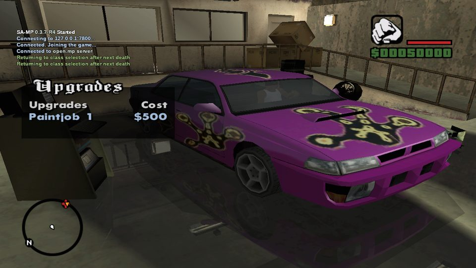
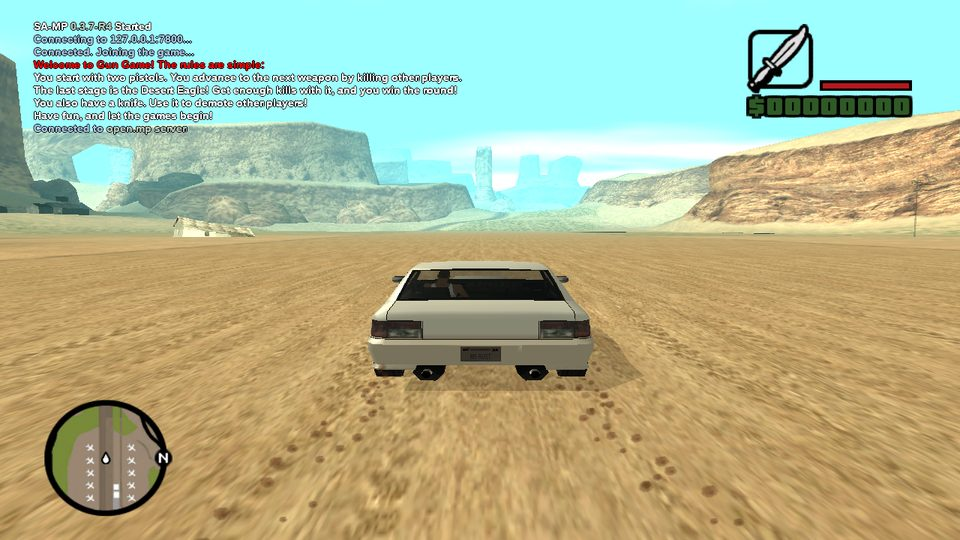
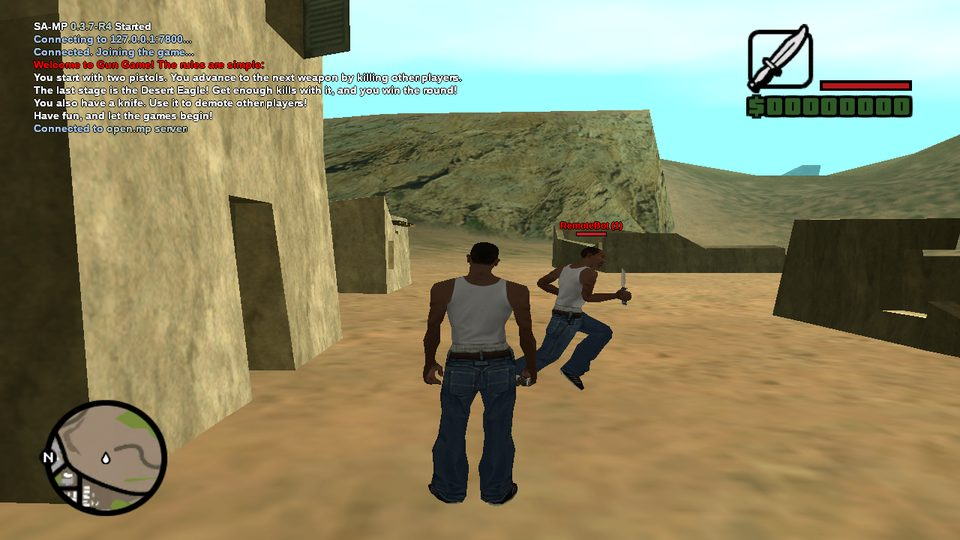
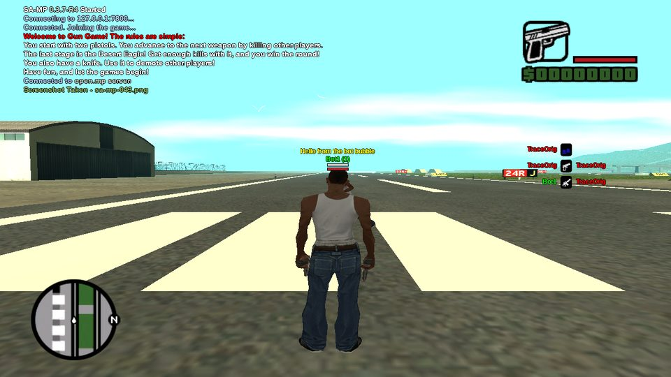
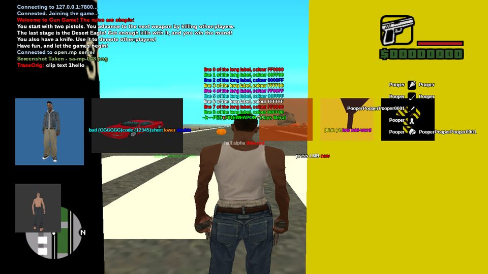
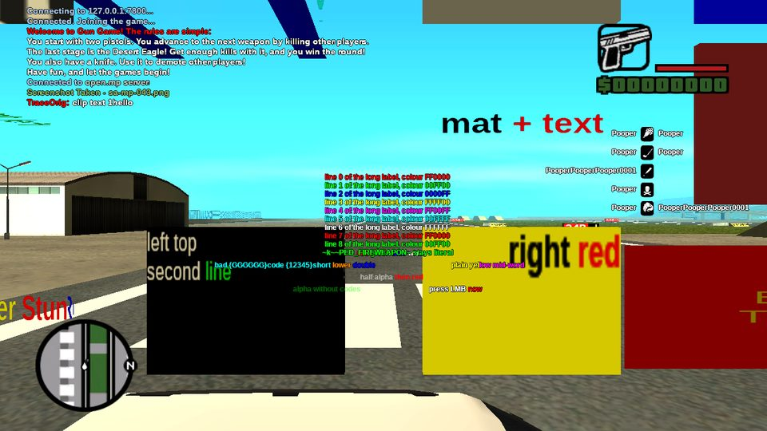

# sandrust-mp

A clean-room reimplementation of the **SA:MP 0.3.7-R4 client** in Rust. It joins existing
**samp-server 0.3.7** and **open.mp** servers, and its behaviour is measured against the original
`samp.dll`, call by call.

<p align="center">
  
  
</p>
<p align="center">
  
  
</p>
<p align="center">
  
  
</p>

<sub>Screenshots of this client, taken on an isolated test display during the visual-parity runs.</sub>

## What it does

The client is a DLL injected into GTA: San Andreas 1.0 US. It replaces `samp.dll` and covers the full
player-facing feature set of 0.3.7-R4:

- **Network**: handshake, packet cipher, RakNet reliability, every RPC and sync packet, reconnects,
  kicks, server restarts.
- **Players and vehicles**: on-foot, driver, passenger, trailer and unoccupied sync, animations,
  special actions, drive-by, trains, mod shops, number plates.
- **Combat**: aiming, bullet sync with all lag-compensation modes, damage, death and respawn.
- **World**: objects (material textures and text, attachments, the object editor), pickups,
  checkpoints, actors, map icons, gang zones, 3D labels, building removal.
- **Interface**: chat and input box, all six dialog styles, textdraws (including model previews),
  menus, scoreboard, nametags, death list, game text, the SA:MP loading screen, local commands, F8
  screenshots, `sa-mp.cfg`.
- **Audio**: audio streams through the BASS library of the user's SA:MP install.

SA:MP's own data (`samp.saa`, `bass.dll`) is read at runtime from the user's SA:MP installation and
is never shipped with this project.

## How parity is verified

Every feature is compared with the original client on the same input, and a feature is only
considered done when the two behave the same. The acceptance criteria (`docs/PLAN.md`) are each
proven by a script that exits 0 only when nothing unexplained differs:

| Criterion | What is compared | Script |
|---|---|---|
| F1 | The game-side reaction to every server RPC: GTA function calls, game state, screen | `tools/diff/rpc-coverage.sh` |
| F2 | Every client→server message: format, reliability, channel, timing | `tools/diff/network.sh` |
| F3 | The original client and this one on one server, each watching the other | `tools/diff/cross-client.sh` |
| F4 | The Direct3D call stream of every UI element | `tools/diff/visual.sh` |
| F5 | Every memory patch the original applies to `gta_sa.exe` | `tools/diff/patch-coverage.sh` |
| F6 | The files served from `samp.saa` | `tools/diff/files.sh` |
| F7 | Two-hour soak on each bundled gamemode, with reconnect, kick and restart cases | `tools/e2e/soak.sh` |

The comparisons use a tracer DLL (`crates/samp-tracer`) that hooks the same GTA functions, the
Direct3D device and the network in both clients. Where the original itself varies from run to run,
or where a difference is deliberate, the decision and its evidence are recorded in
[`docs/ROADMAP.md`](docs/ROADMAP.md) under "Decisions made autonomously".

## Requirements

- GTA: San Andreas **1.0 US** (`gta_sa.exe`).
- An installed SA:MP 0.3.7 client, for `samp.saa` and `bass.dll`.
- Windows, or Linux with Wine (developed and tested with Wine 11 and DXVK).
- Rust stable with the `i686-pc-windows-gnu` target (and a MinGW-w64 linker) to build the DLL.

## Build and run

```sh
rustup target add i686-pc-windows-gnu
cargo build --release --target i686-pc-windows-gnu -p samp-client -p samp-launcher

# Linux / Wine: builds, installs the DLL into the game folder and connects
tools/run-client.sh 127.0.0.1:7777 YourName
```

`tools/run-client.sh` uses the Wine prefix and game copy set up by `tools/wine-env.sh`
(`WINEPREFIX`, `GTA_DIR`). On Windows, copy `samp-launcher.exe` and `samp_client.dll` into the game
folder and run:

```bat
samp-launcher.exe --gta gta_sa.exe --dll samp_client.dll --name YourName --host 127.0.0.1 --port 7777
```

The headless test client needs no game at all:

```sh
cargo run -p samp-bot -- 127.0.0.1:7777
```

## Repository layout

| Path | Contents |
|---|---|
| `crates/samp-proto` | Wire protocol: cipher, handshake, RakNet layer, typed RPC and sync codecs |
| `crates/samp-client` | The in-game client DLL |
| `crates/samp-ui` | Renderer-independent UI logic (chat, dialogs, textdraws, commands, config) |
| `crates/samp-launcher` | Starts the game suspended and injects the client |
| `crates/samp-saa` | Reader for SA:MP's `samp.saa` archive |
| `crates/samp-bot` | Headless client used as test players |
| `crates/samp-tracer`, `crates/samp-dump` | Measurement tools: call tracer and capture decoder |
| `docs/re/` | Protocol and behaviour specifications, written from scratch ([index](docs/re/README.md)) |
| `docs/PLAN.md`, `docs/ROADMAP.md` | Definition of done, task board and decisions |
| `tools/` | Test, comparison and setup scripts |

## Status

All seven parity criteria (F1–F7) pass for the 0.3.7-R4 client under Wine. Open work: support for
other client versions (R1, R3, R5, 0.3.DL), a validation run on Windows, and a few unmeasured details
listed in the roadmap.

## Legal

This is an independent, clean-room project for interoperability with existing servers. Specifications
are written in our own words from observed behaviour; no SA:MP or RakNet source code is used, and no
SA:MP, GTA or other third-party files are distributed. It is not affiliated with SA:MP, open.mp or
Rockstar Games. A licence has not been chosen yet.
